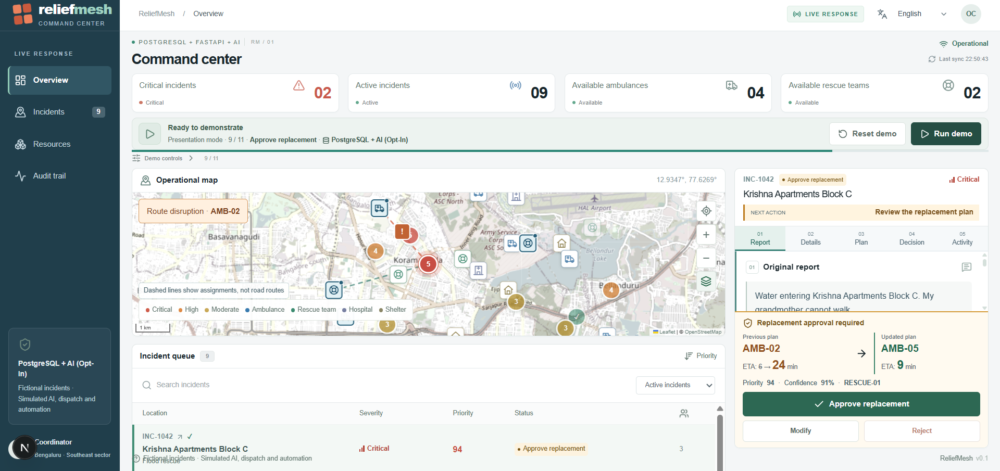
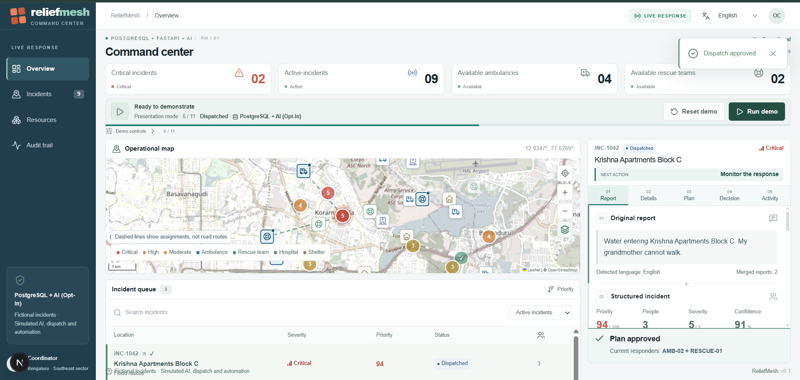
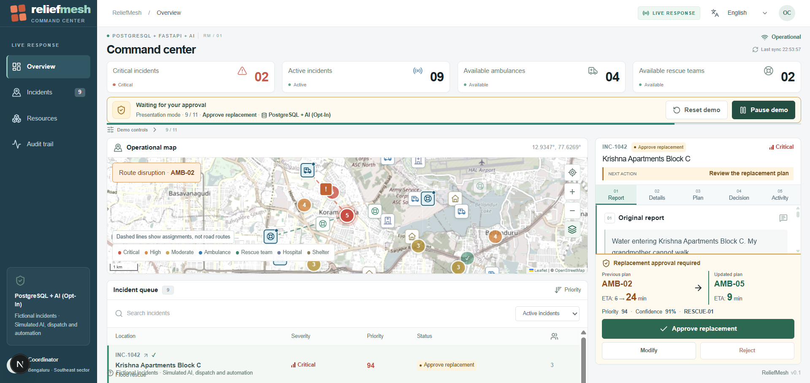
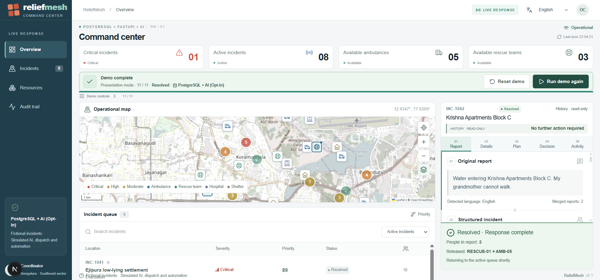
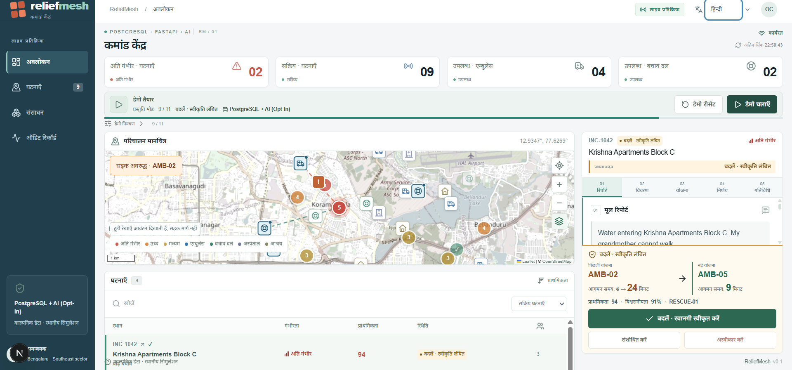
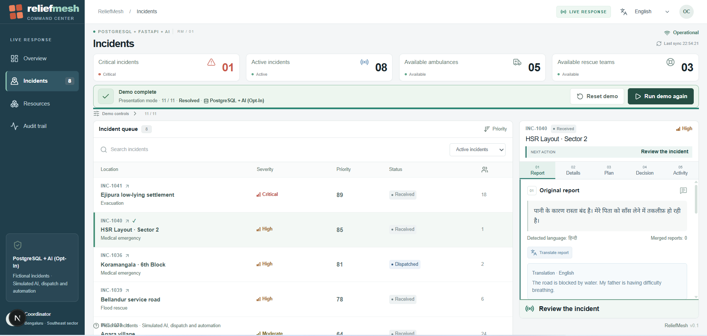
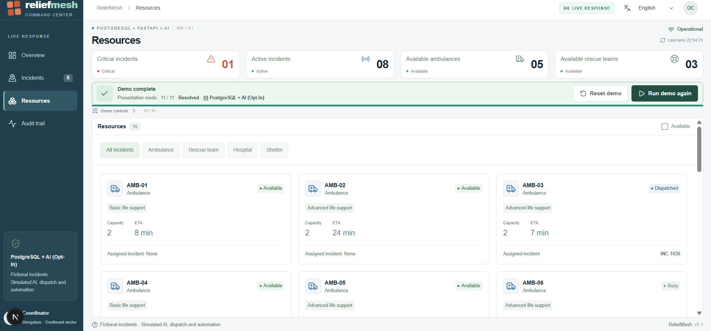
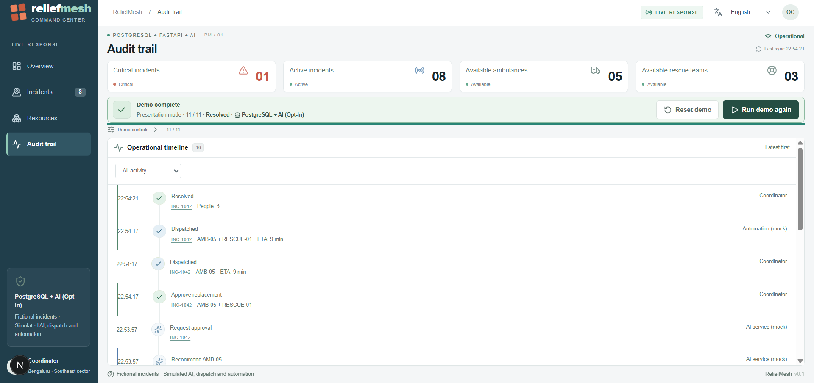
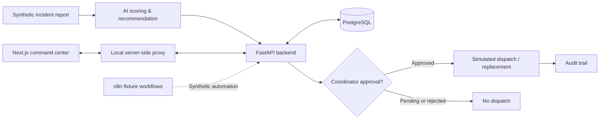

# ReliefMesh
### AI-assisted disaster response coordination | Solo, AI-assisted engineering project

[](https://github.com/shawryuhh/ReliefMesh/actions)
[](https://github.com/shawryuhh/ReliefMesh/actions)

**ReliefMesh** is an interactive disaster-response command center prototype that combines multilingual incident reporting, priority scoring, resource recommendations, human approval, and a traceable incident lifecycle. Its flagship scenario simulates a Bengaluru flood emergency, an ambulance delay, a replacement recommendation, and successful resolution.

> **Demonstration only.** All incident data and dispatch actions shown are synthetic. ReliefMesh does not contact real emergency responders or provide a production emergency service. The AI and automation features use deterministic logic and local fixtures where external services are not configured.



## Highlights

- **Incident command center:** interactive map, severity indicators, incident queue, and resource availability.
- **Multilingual interface:** language selection across 13 languages, including Hindi and Kannada.
- **AI-assisted triage:** deterministic priority scoring and capability-aware resource recommendations.
- **Human-in-the-loop controls:** recommendations require coordinator approval before simulated dispatch or replacement.
- **Roadblock recovery:** proposes a new ambulance when the original responder is delayed, while preserving the existing rescue-team assignment.
- **Auditability:** chronological activity history and versioned recommendations.
- **Two demo modes:** self-contained simulated fallback and an opt-in local PostgreSQL-backed demo.

## Demo walkthrough

| Stage | What the prototype demonstrates |
| --- | --- |
| Intake | A synthetic report is received and classified. |
| Analysis | The incident is assigned priority 94/100. |
| Initial plan | AMB-02 and RESCUE-01 are recommended. |
| Human approval | The coordinator approves simulated dispatch. |
| Disruption | A flooded road increases AMB-02's ETA from 6 to 24 minutes. |
| Replanning | AMB-05 is proposed with a 9-minute ETA. |
| Replacement approval | AMB-05 replaces AMB-02; RESCUE-01 remains assigned. |
| Resolution | Responders are released and the incident moves to history. |

### Human-approved dispatch



### Roadblock and replacement recommendation



### Incident resolution



## Screenshots

| Multilingual interface | Incident management |
| --- | --- |
|  |  |
| **Resource management** | **Audit trail** |
|  |  |

[View the language selection screen](docs/screenshots/language-selection.png) · [View the expanded operational map](docs/screenshots/operational-map.png)

**Language note:** The UI language can change independently of the original language of a submitted report. The original report is preserved; available translations are displayed separately. The presence of a localized UI does not imply that arbitrary report text is automatically translated into every language.

## Architecture



| Layer | Technologies | Role |
| --- | --- | --- |
| Frontend | Next.js, React, TypeScript, Leaflet | Dashboard, maps, decision controls |
| Backend | FastAPI, SQLAlchemy, Alembic | Business rules, state transitions, authorization |
| Database | PostgreSQL | Incidents, resources, assignments, audit history |
| AI | Python, Pydantic, optional Gemini provider | Scoring, structured analysis, recommendations |
| Automation | n8n workflow exports, local fixture harness | Synthetic event and notification flow |
| Testing | Pytest, Node test runner, GitHub Actions | Unit, database, and integration checks |

## Getting started

**Requirements:** Node.js 22.18+, Python 3.12, and PostgreSQL 16 for the backend-backed demo.

Clone the portfolio release from the default `main` branch:

```powershell
git clone https://github.com/shawryuhh/ReliefMesh.git
cd ReliefMesh
```

### Quickest: simulated frontend

```powershell
cd frontend
npm ci
npm run dev
```

Open **http://localhost:3000**. The self-contained simulation is the easiest way to explore the UI without setting up database credentials.

### PostgreSQL-backed local demonstration

The backend-backed demo additionally requires a **dedicated local test database**, Alembic migrations, and local-only authentication/environment variables. See [INTEGRATION_RUNBOOK.md](INTEGRATION_RUNBOOK.md) and the backend/frontend configuration examples. Never run the demo reset command against a database with important data.

For backend, AI, and n8n testing, consult the component READMEs and the workflows in `.github/workflows/`.

## Verification

The portfolio release was verified before merging to `main`: 55/55 frontend tests passed, TypeScript checks and the Next.js production build passed, backend PostgreSQL checks passed, AI and fixture-only n8n tests passed, and the PostgreSQL + FastAPI + Next.js integration smoke test passed. The complete simulated demo was also manually verified on Windows. These checks validate the hackathon/portfolio demonstration; they are not production certification.

[View CI runs](https://github.com/shawryuhh/ReliefMesh/actions)

## Limitations and safety

- **No real dispatch:** all response actions are simulated.
- **Local demo access only:** the opt-in backend mode is not a public multi-user service.
- **AI scope:** scoring and recommendations are deterministic in the demo; unstructured extraction and translation may use validated fixtures without external model credentials.
- **Automation scope:** n8n workflows are tested with a fixture harness; do not interpret them as live responder communications.
- **Human approval:** the demonstration requires explicit coordinator decisions for initial dispatch and replacement.
- **Not production-ready:** further authentication, data protection, resilience, and field validation would be needed for real-world use.

## Development and ownership

ReliefMesh is presented as a **solo, AI-assisted development project**, developed using coding assistants including ChatGPT and Gemini/Antigravity. The author directed the project, integrated and tested the prototype, and iterated on its workflows. This does not imply every line was written without assistance.

**Repository:** [shawryuhh/ReliefMesh](https://github.com/shawryuhh/ReliefMesh)

---

*Built as a hackathon-style engineering prototype and internship portfolio project.*
